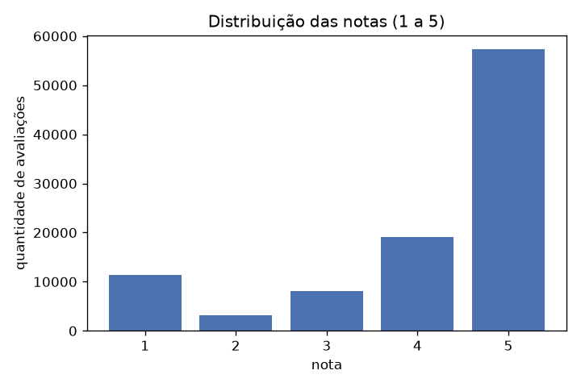
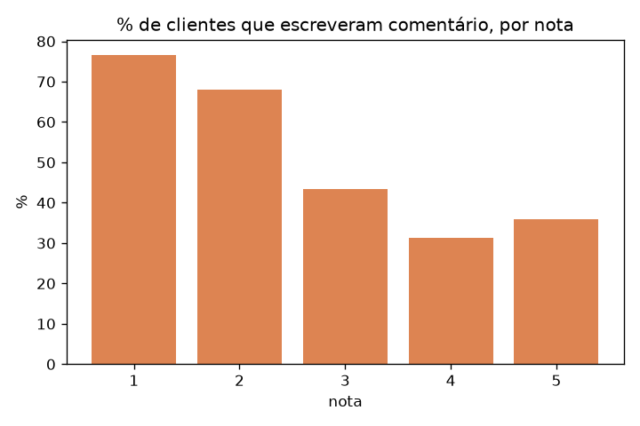
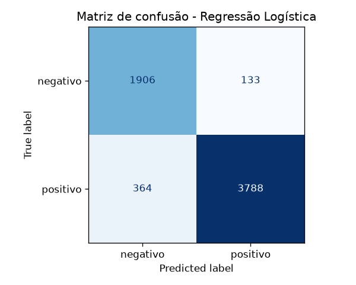
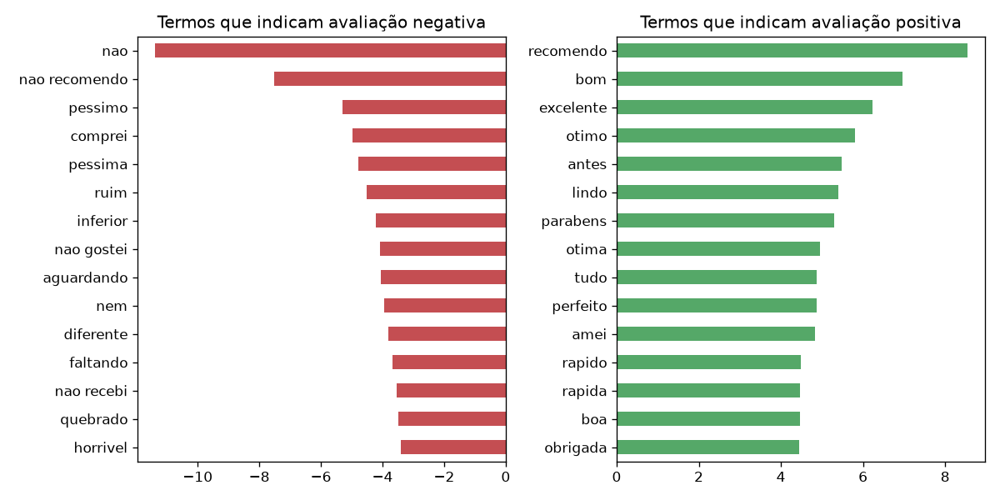
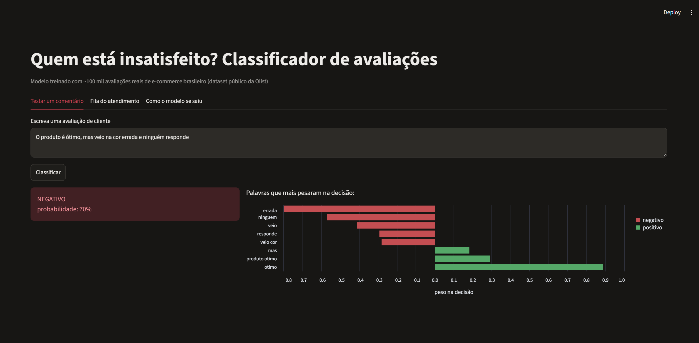
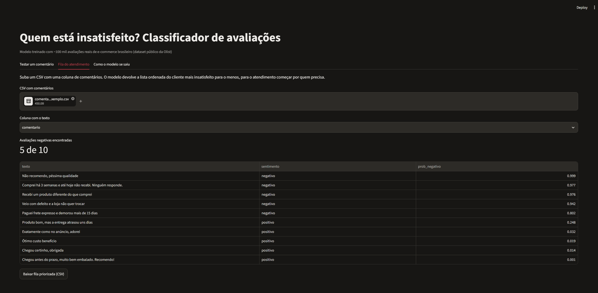
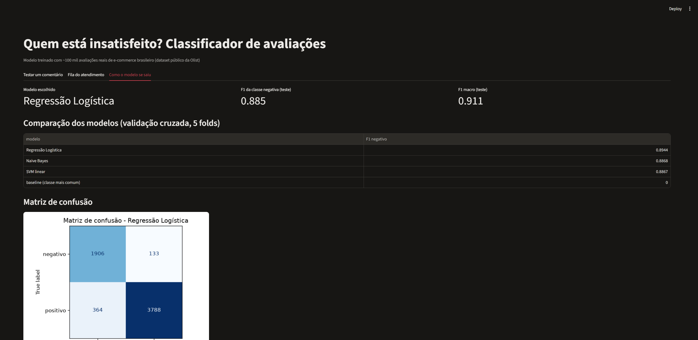
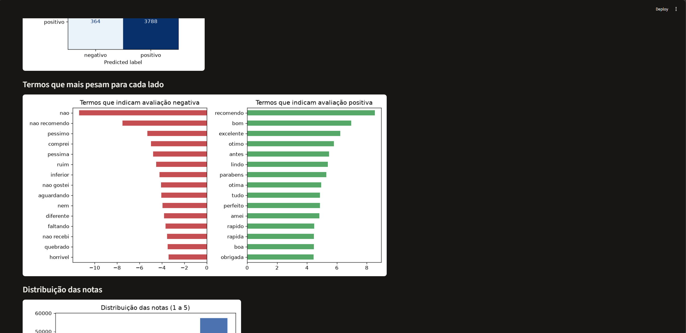

# Análise de sentimento em avaliações de e-commerce (Olist)

Modelo de machine learning que classifica avaliações de clientes em **positivas ou negativas** a partir do texto, usando cerca de 100 mil avaliações reais de pedidos feitos no e-commerce brasileiro (dataset público da Olist).

## O problema

Uma loja online recebe centenas ou milhares de avaliações por mês. Ler uma por uma não escala, e olhar só a nota (1 a 5) esconde muita coisa: tem cliente que dá nota média e escreve uma reclamação séria, e a reclamação que ninguém lê vira cliente perdido, nota baixa no marketplace e, às vezes, reclamação pública.

A ideia aqui é usar o **texto** para encontrar automaticamente os clientes insatisfeitos e montar uma **fila de prioridade para o atendimento**, começando por quem está mais insatisfeito.

## Dados

[Brazilian E-Commerce Public Dataset by Olist (Kaggle)](https://www.kaggle.com/datasets/olistbr/brazilian-ecommerce). Uso o arquivo `olist_order_reviews_dataset.csv`, que deve ficar em `data/`.

## Etapas

**1. Exploração (`eda.py`)**
- Distribuição das notas de 1 a 5
- Quantos clientes escrevem comentário, por nota
- Tamanho dos textos positivos x negativos

**2. Preparação do texto (`src/texto.py`)**
- Junta título + comentário
- Minúsculas, sem acentos, sem números, links e pontuação
- Remove stopwords, **mas mantém as negações** ("não", "nunca", "nem"). Listas prontas costumam apagar o "não", e aí "não chegou" vira "chegou"
- Rótulo: nota 1-2 = negativo, 4-5 = positivo. A nota 3 fica de fora porque é ambígua
- Remove textos duplicados para o mesmo comentário curto ("ótimo") não aparecer no treino e no teste ao mesmo tempo

**3. Modelagem (`train.py`)**
- Separação treino/teste (80/20) estratificada, feita antes de qualquer ajuste
- TF-IDF com unigramas e bigramas (pega expressões como "nao recomendo")
- Comparação com validação cruzada de 5 folds: baseline, Naive Bayes, Regressão Logística e SVM linear
- Métrica principal: **F1 da classe negativa**, porque ela é a minoria e é a que interessa encontrar. Acurácia engana em base desbalanceada
- `class_weight="balanced"` para compensar o desbalanceamento

**4. Avaliação e interpretação**
- Relatório de classificação e matriz de confusão no teste
- Palavras que mais pesam para cada lado
- Os erros do modelo vão para `reports/erros_modelo.csv`, para leitura manual

## O que a exploração mostrou

- 99.224 avaliações, 41,3% com comentário escrito
- 57,8% das notas são 5 e só 14,7% são 1 ou 2, mas quem está insatisfeito escreve muito mais:
  76,5% de quem dá nota 1 deixa comentário, contra 35,9% de quem dá nota 5
- Comentários negativos têm em média 17 palavras, quase o dobro dos positivos (9)
- Depois da limpeza e da remoção da nota 3 e de duplicados, a base do modelo ficou com
  30.951 avaliações: 67,1% positivas e 32,9% negativas




## Resultados

| Modelo | F1 negativo (validação cruzada) |
|---|---|
| Baseline (sempre "positivo") | 0,000 |
| Naive Bayes | 0,887 (± 0,008) |
| **Regressão Logística** | **0,894 (± 0,006)** |
| SVM linear | 0,887 (± 0,003) |

Modelo escolhido: **Regressão Logística**. No teste (6.191 avaliações que o modelo nunca viu):

| | Precisão | Recall | F1 |
|---|---|---|---|
| Negativo | 0,840 | 0,935 | 0,885 |
| Positivo | 0,966 | 0,912 | 0,938 |

F1 macro = 0,912 | Acurácia = 0,920

Na prática, o modelo encontra 93,5% dos clientes insatisfeitos, e 84% dos que ele marca como negativos são de fato negativos.

O termo que mais pesa para o lado negativo é "nao", seguido de "nao recomendo", o que confirma a decisão de manter as negações na limpeza do texto.




**O que aprendi com os erros:**

Dos 497 erros no teste, 364 são avaliações com nota 4 ou 5 que o modelo classificou como negativas, e 133 são notas 1 ou 2 classificadas como positivas. Lendo os casos, encontrei três padrões:

1. **A nota não bate com o texto.** Muitos clientes dão 4 ou 5 estrelas e escrevem uma reclamação: "Ainda não recebi o produto", "O produto veio com defeito", "Comprei na cor azul e veio rosa". O contrário também acontece: nota 1 com "Recomendo" ou "Tudo Ok". Nesses casos o modelo leu o texto corretamente; o erro está no rótulo. Isso reforça o objetivo do projeto: a nota sozinha esconde reclamações que o texto revela.
2. **Avaliações mistas.** "O produto é ótimo, mas veio na cor errada" tem elogio e reclamação ao mesmo tempo, e um rótulo único não dá conta disso. Um próximo passo seria classificar por aspecto (produto, entrega, atendimento).
3. **Textos curtos ou sem conteúdo.** "Entrega", "Cadeira", "Receb" não têm informação suficiente para nenhum modelo.

## Como rodar

```bash
python -m venv .venv
.venv\Scripts\activate        # Windows  (Linux/Mac: source .venv/bin/activate)
pip install -r requirements.txt

python eda.py
python train.py
python predict.py "produto chegou quebrado e ninguém responde"
streamlit run app.py
```

## App em Streamlit (`app.py`)

- **Testar um comentário:** classifica o texto e mostra quais palavras mais pesaram na decisão (contribuição de cada termo = peso no modelo × valor TF-IDF)
- **Fila do atendimento:** recebe um CSV de comentários e devolve a lista ordenada do mais insatisfeito para o menos, pronta para baixar. Tem um arquivo de teste em `exemplos/comentarios_exemplo.csv`
- **Como o modelo se saiu:** métricas, comparação entre modelos e os gráficos do treino






## Tecnologias

Python, pandas, scikit-learn, matplotlib, NLP (TF-IDF), joblib, Streamlit.

## Próximos passos

- Testar um modelo de linguagem pré-treinado em português (BERTimbau) e comparar com o TF-IDF
- Classificar também o **motivo** da reclamação (atraso, produto errado, defeito)
- Expor o modelo numa API (FastAPI) para integrar direto com o sistema de atendimento
